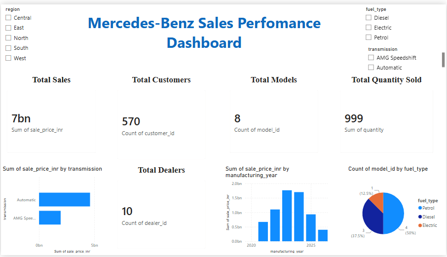
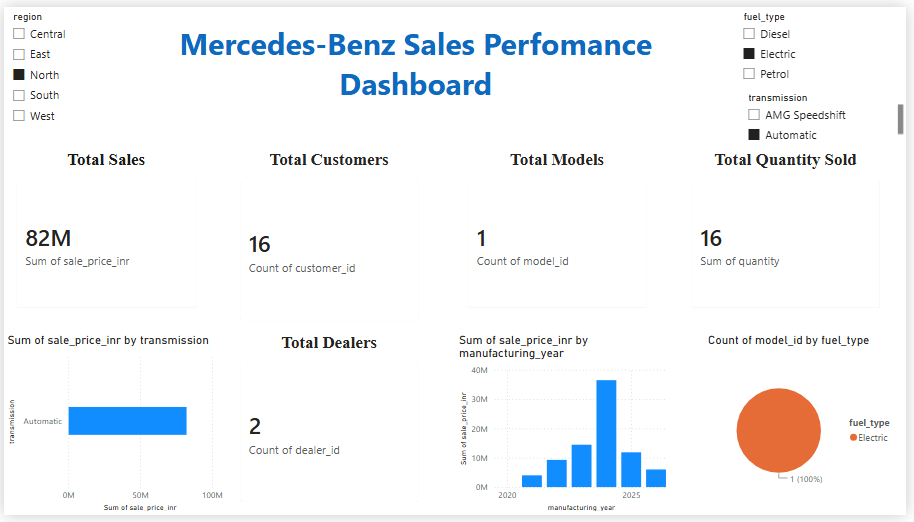
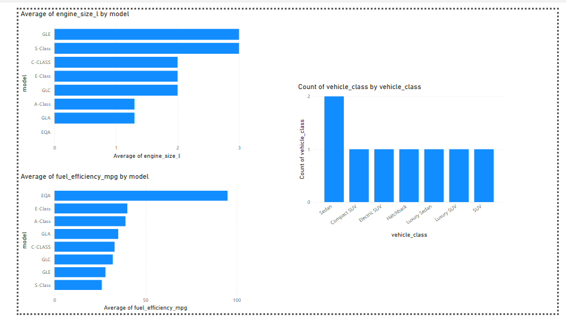
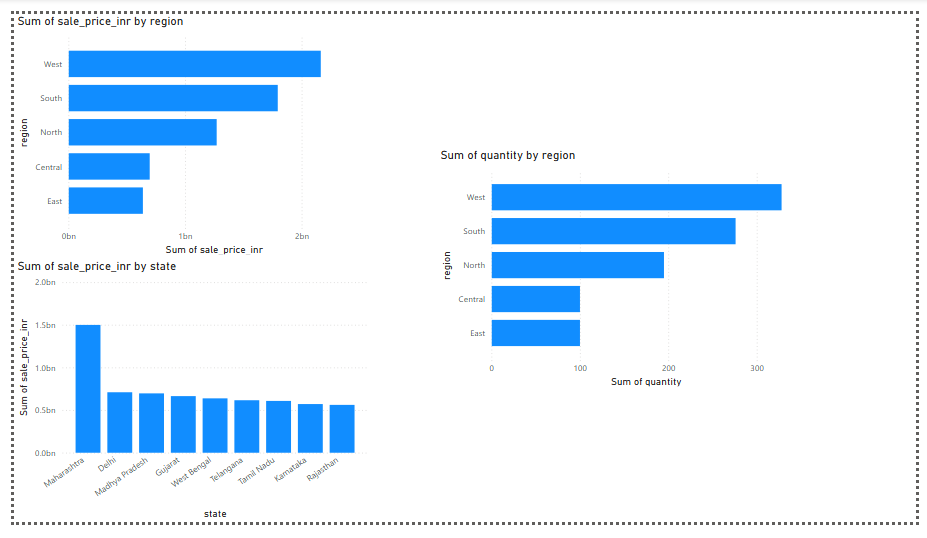

# Mercedes-Benz Sales Performance Analytics

## Project Overview
An end-to-end Automotive Sales Analytics and Data Engineering solution for Mercedes-Benz vehicle transactions. This project processes raw sales data across a Databricks Lakehouse Medallion Architecture (Bronze, Silver, Gold), models it into a dimensional Star Schema, and delivers executive business insights through interactive web and Power BI dashboards.

## Business Objectives
- **Sales Performance Tracking**: Measure total revenue, vehicle units sold, and average price across categories.
- **Model & Segment Analysis**: Compare vehicle classes, fuel types, engine displacements, and transmissions.
- **Regional Distribution**: Identify top-performing territories, dealerships, and regional demand trends.
- **Data Engineering & Reliability**: Ingest, cleanse, deduplicate, and model high-volume transactions using PySpark and Databricks.

## Tech Stack
| Layer | Technologies |
|---|---|
| **Big Data Engineering & Lakehouse** | Databricks, PySpark, Delta Lake |
| **Data Processing & ETL** | Python (Pandas, NumPy) |
| **Data Storage & Modeling** | MySQL, Star Schema (Fact & Dimension Tables) |
| **Interactive Web Dashboard** | React, Vite, Recharts, Lucide Icons |
| **Business Intelligence (BI)** | Power BI Desktop |
| **Version Control & CI/CD** | Git, GitHub, GitHub Actions |

---

## Databricks & PySpark Medallion Architecture
- **Bronze Layer (`03_Bronze_layer.py`)**: Raw data ingestion with ingestion timestamps and source system audit tracking.
- **Silver Layer (`04_Silver_layer.py`)**: Cleansing, deduplication, null handling, and string standardization using PySpark DataFrame operations.
- **Gold Layer (`05_Gold_Layer.py`)**: Star Schema modeling creating Dimension tables (`gold_dim_model`, `gold_dim_dealer`, `gold_dim_customer`, `gold_dim_date`) and the Fact table (`gold_fact_sales`) using PySpark window functions.
- **Business KPIs (`06_Business_KPIs.sql`)**: Databricks SQL analytical queries calculating revenue, top models, regional distributions, and sales volume.

---

## Power BI Dashboard Previews

### 1. Sales Performance Dashboard


### 2. Sales Performance with Interactive Slicers


### 3. Technical Comparison


### 4. Geographic & Regional Analysis


---

## Repository Structure
- **notebooks/**: Databricks PySpark notebooks implementing Bronze, Silver, Gold layers, and KPI SQL queries.
- **dashboard/**: React + Vite web dashboard application.
- **data/**: Raw CSV inputs and processed datasets.
- **python/**: Local Python ETL pipeline scripts and data generator.
- **sql/**: Schema definitions and analytical SQL queries.
- **powerbi/**: Power BI workbook and dashboard screenshots.
- **.github/workflows/**: Automated CI/CD pipeline for dashboard deployment.

---

## How to Run Locally

### 1. Run Data ETL Pipeline
```bash
# Generate and clean dataset
python python/generate_synthetic_data.py
python python/run_pipeline.py
```

### 2. Run the Interactive React Dashboard
```bash
cd dashboard
npm install
npm run dev
```

---

*Note: All data in this repository is demonstration automotive transaction data generated for portfolio and analytics modeling purposes.*